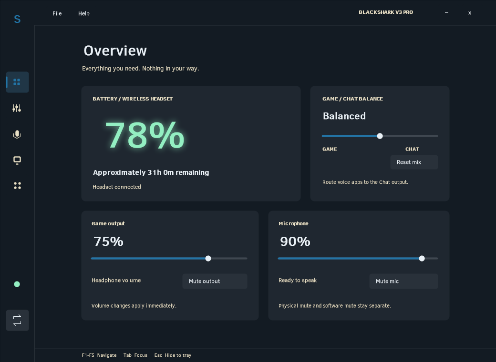
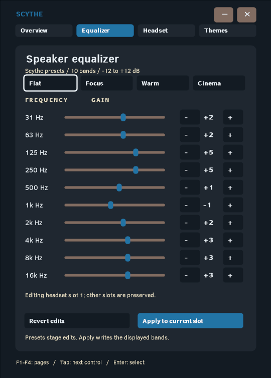
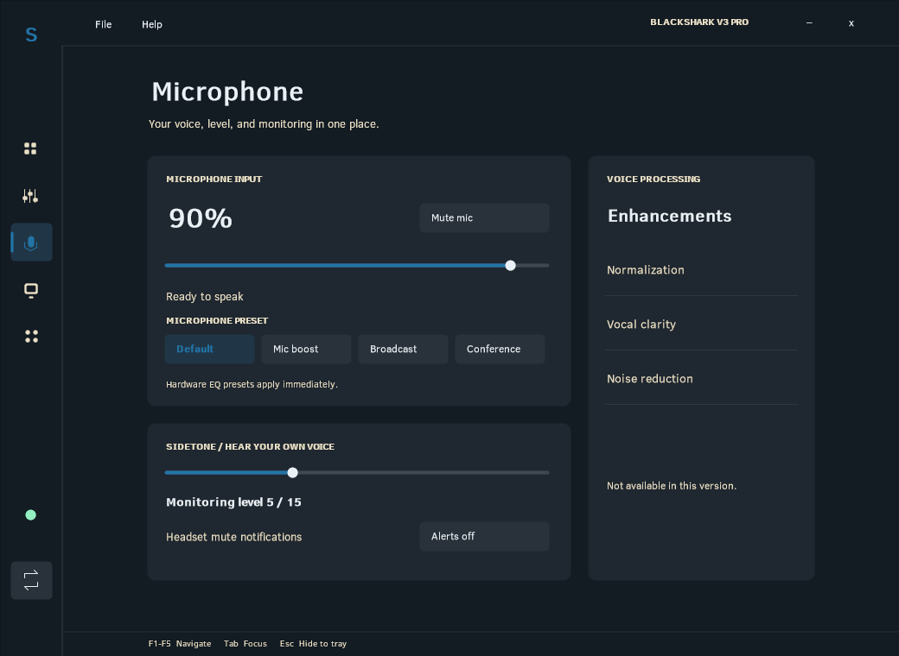
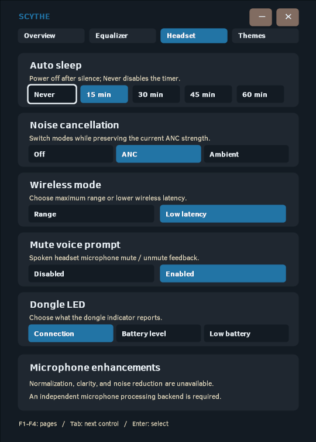
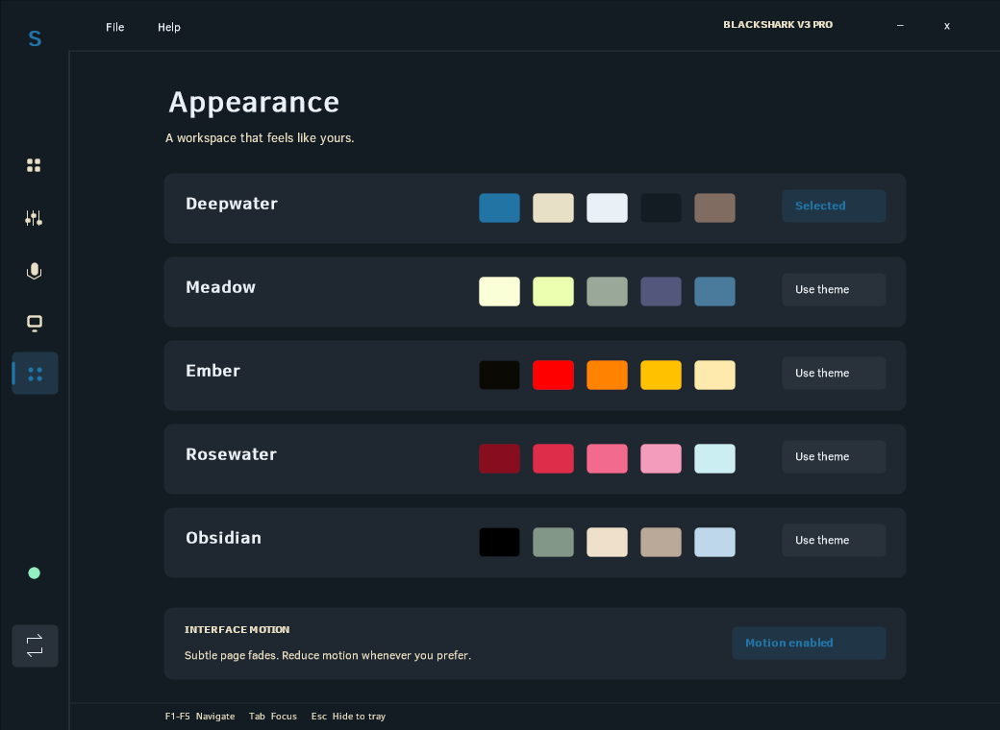
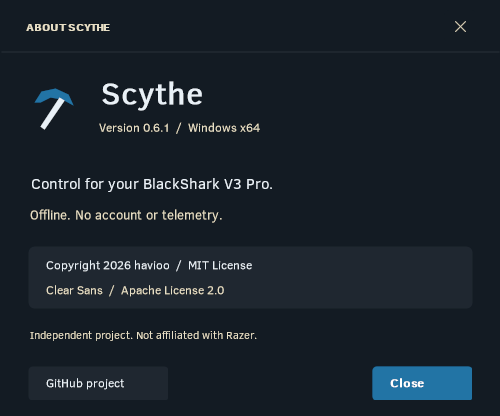

# Scythe

A lightweight Windows tray app for the **Razer BlackShark V3 Pro**. Battery, volume, Game/Chat balance, and microphone controls in one small dashboard.

Scythe runs locally. No accounts, telemetry, cloud profiles, or updater. Built with Rust and native Windows APIs, without a browser runtime.

[Download v0.6.1 for Windows x64](https://github.com/havioo/scythe/releases/download/v0.6.1/Scythe-v0.6.1-windows-x64.zip) · [Release notes](#changelog)

## Why choose Scythe?

For BlackShark V3 Pro owners who want the supported everyday headset controls, Scythe offers a small native app that works offline without an account or telemetry.

Observed on the same Windows machine on October 26, 2026 (Scythe 0.5.0; Synapse / Razer App Engine 4.0.827.114):

| Resource | Scythe | Synapse / Razer App Engine |
| --- | --- | --- |
| RAM: summed process working sets | 22.0 MiB (1 process) | 1,981.9 MiB - 2,067.4 MiB (13 processes) |
| Private committed memory | 5.5 MiB | 1,118.0 MiB - 1,225.5 MiB |
| App files | 1.0 MiB, including bundled licenses | 462.0 MiB installed App Engine files |
| Local App Engine data, including downloaded apps and caches | No equivalent app cache; Scythe saves a small notification settings file | 590.3 MiB |

That is about **99% less summed working-set memory** in this observation, with a roughly **1 MiB distribution** versus **1,052 MiB of App Engine files and local data** on this machine. Scythe is a lighter choice when its supported controls cover your needs.

These are observations, not a controlled benchmark or a guarantee. Memory was sampled three times, five seconds apart, with Scythe running in the tray and Synapse started for measurement; window states and workloads were not matched. Summed working sets can count shared pages more than once; private committed memory is a separate metric, not physical RAM usage. Storage is the sum of file lengths, excludes shared audio drivers and other Razer components, and is not a prediction of space recovered by uninstalling. Synapse provides broader device support and features Scythe does not implement, including firmware updates and THX controls. See the [measurement record](docs/resource-usage-2026-10-26.json), [support table](#current-support), and [telemetry analysis](TELEMETRY.md).




The screenshots and walkthrough use example values rendered by Scythe itself; creating them does not change headset settings.

## Current support

**Version 0.6.1 | Windows x64 | BlackShark V3 Pro**

The BlackShark V3 Pro connected through its USB wireless dongle is the verified configuration. Other headset models, Bluetooth control, and analog connections are not supported. Hardware features may depend on firmware.

| Feature | Status |
| --- | --- |
| Battery percentage and charging | Supported |
| Wireless headset connection status | Supported |
| Estimated battery runtime | Supported after learning discharge behavior |
| Game output volume and mute | Supported through Windows Core Audio |
| Hardware Game/Chat balance | Supported, with center reset |
| Microphone volume and software mute | Supported through Windows Core Audio |
| Physical headset mute detection | Supported |
| Headset mute notifications | Optional Windows alert |
| Microphone EQ | Default, Mic boost, Broadcast, Conference |
| Sidetone | 0-15 |
| Speaker EQ | Flat, eSports, FPS, Music, Focus, Warm, Cinema; 10 custom bands (-12 to +12 dB) |
| Auto sleep | Never, quick presets, or custom whole minutes (1-255) |
| Noise cancellation | Off, ANC, Ambient; preserves current strength |
| Wireless mode | Range or low latency, with HID reconnect handling |
| Mute voice prompt | Enable/disable spoken microphone mute feedback |
| Dongle LED | Connection, battery level, or low-battery warning |
| Themes | Deepwater, Meadow, Ember, Rosewater, Obsidian |
| THX, microphone enhancements, firmware updates | Not implemented |
| Other headset models | Not yet supported |

## Using Scythe

Extract the release ZIP and run `Scythe.exe`, or build the app below and run `target/release/scythe.exe`. It starts in the Windows notification area; the icon may be inside the hidden-icons menu.

- Hover for a compact battery, microphone, and Game-volume preview.
- Click the tray icon to open the dashboard.
- Drag the custom header to move the borderless window.
- Use the close button or Escape to hide the dashboard while Scythe stays running. Minimize uses the Windows taskbar.
- Use File > Quit Scythe, Alt+F4, or the tray menu to quit. Help > About Scythe opens a borderless dialog using the selected Scythe theme, embedded Clear Sans, and custom-drawn accessible controls for version, project, and license information.

Route games to the headset's **Game** output and voice chat to **Chat**. The hardware mixer leaves both channels at full level in the center; moving toward one side lowers the other channel. The Game volume slider separately controls the Windows Game endpoint.

Software microphone mute and physical headset mute are separate. Release a physical mute using the headset button. Enable **Headset mute notifications** for an alert when the physical button changes from unmuted to muted. Alerts default off; Windows notification settings may suppress them.

The live tray and taskbar/window icons use the same thresholds for the scythe blade, with neutral gray for unknown readings. The handle stays neutral. Icon resources are replaced only when the color tier changes; a closed app's pinned shortcut is static.

Battery glow is green at 60-100%, yellow at 20-59%, and red at 0-19%. Unknown readings stay neutral. Runtime estimation requires at least 20 minutes and a drop of 3 percentage points. Charging, a percentage increase, missing data, or exit resets learning. Estimates are approximate; no battery history is saved.

The dashboard uses privately embedded Clear Sans, antialiased native drawing, and the selected local theme. Fonts are not installed globally.

When the headset reports charging, a slow highlight sweeps across the battery number and percent sign in both Overview and the tray preview. Battery-level colors remain visible; light themes use darker text shades for readability. Reduce Motion and Windows animation preferences disable the shimmer while preserving the Charging label. Charging status is checked every five seconds. Animation runs only while a charging display is visible.

The tray preview uses a per-pixel-alpha window with antialiased transparent corners, rather than an opaque rectangular background.

## Navigation and equalizer

The sidebar separates Overview, Sound Studio, Microphone, Device, and Appearance. File contains hide and quit; Help contains the single About entry and keyboard shortcuts. The sidebar starts as a compact icon rail and expands smoothly on hover or keyboard focus. Page content adjusts with the rail so navigation never covers controls.

Use **Sound Studio** to stage a Scythe preset or adjust the ten vertical faders. The response plot shows the staged EQ curve. **Apply to current slot** writes those bands to the current headset slot. Other slots and their metadata are preserved. **Revert edits** discards staged changes and displays the latest device readback. These presets are Scythe curves, not Synapse cloud profiles. Applying a curve replaces the current slot's bands; note existing values if you want to restore them later.

The **Device** page contains the sleep timer, ANC/Ambient modes, wireless mode, microphone mute voice prompt, and dongle LED mode. Buttons remain disabled when a setting cannot be read. Changes require device acknowledgement and readback. Wireless mode changes can reconnect the control interface; Scythe reopens it automatically.

Microphone normalization, vocal clarity, and noise reduction are unavailable. They require an independent audio-processing backend; this version does not load THX/vendor libraries or create a processed virtual microphone.







## Appearance

Choose a theme on the **Appearance** page. The choice is saved locally and applies to the dashboard and compact preview. Battery status retains its green/yellow/red colors.

| Theme | Palette |
| --- | --- |
| Deepwater | `2274a5` `e7dfc6` `e9f1f7` `131b23` `816c61` |
| Meadow | `faffd8` `ecffb0` `9aa899` `54577c` `4a7b9d` |
| Ember | `0a0903` `ff0000` `ff8200` `ffc100` `ffeaae` |
| Rosewater | `880d1e` `dd2d4a` `f26a8d` `f49cbb` `cbeef3` |
| Obsidian | `000000` `839788` `eee0cb` `baa898` `bfd7ea` |





Use F1-F5 to switch sections, or F6 to move between navigation and page controls. In navigation, Up/Down moves focus, Home/End selects the first/last item, and Enter opens the focused section. Tab/Shift+Tab cycles controls; Enter or Space selects a control. Arrow keys adjust focused sliders, and Home/End jump to their endpoints. Custom minutes supports typing, selection, caret movement, and paste.

Page transitions use a short eased fade, and sidebar expansion uses a 280 ms eased transition. Sidebar animation reuses a rendered page and a persistent back buffer, with a short-lived compositor-paced frame pump; it releases the timer request when movement ends. Reduce Motion is saved in preferences, and Windows animation preferences are respected. Animations stop after the transition and do not run continuously while hidden.

## Changelog

### v0.6.1 — October 26, 2026

- Refreshed the native dashboard with a compact sidebar that expands on hover or keyboard focus, smoother compositor-paced movement, and reduced-motion support.
- Removed the View menu and duplicate About entry. Menu highlights clear when dismissed; keyboard focus remains distinct from mouse hover.
- Replaced the Windows-style About prompt with a Scythe-themed modal, embedded Clear Sans text, accessible controls, and clean surfaces without edge lines.
- Added a transparent multi-resolution `.ico`, embedded file/version resources, and battery-aware live tray/taskbar icons.
- Added native accessibility names, roles, values, states, actions, and change notifications, plus F6 navigation and clearer keyboard focus outlines.
- Added glyph-clipped charging shimmer and antialiased transparent tray-preview corners.
- Added custom sleep minutes from 1 to 255 with validation and verified readback/restoration.
- Updated all app screenshots and added the animated interface walkthrough above. Thirty-three automated tests, strict Clippy, formatting, and the release build pass locally.

### v0.6.0

Added speaker equalization, headset controls, and selectable themes. See the [v0.6.0 release](https://github.com/havioo/scythe/releases/tag/v0.6.0).

## Build

Requirements: Windows x64, stable Rust with the MSVC toolchain supporting edition 2024, and Visual Studio Build Tools with **Desktop development with C++** and a Windows SDK.

```powershell
git clone https://github.com/havioo/scythe.git
cd scythe
cargo build --release --locked
.\target\release\scythe.exe
```

Cargo downloads dependencies on the first build. The app itself works offline. The release statically links the C runtime and uses Windows system libraries. Scythe does not replace audio drivers and does not use Synapse as its control backend. Working headset drivers and Windows audio endpoints are still required.

The executable embeds `assets/scythe.ico`, version information, and the Windows application manifest during the build. The Windows SDK resource compiler is required (included with the Build Tools/SDK above). `scripts/generate-icon.ps1` regenerates the original Scythe icon without third-party assets.

When distributing a build, include `LICENSE` and the font license and attribution from `assets/fonts` alongside the executable.

The custom timer accepts whole minutes from 1 to 255; Never disables auto-sleep. Invalid input is rejected without writing to the headset.

The verified dongle protocol exposes connection, battery-level, and low-battery indicator modes. Programmable RGB and flashing effects remain unavailable. On the tested firmware, the shared Spectrum setter returned a nonzero result and the effect readback stayed unchanged, including in temporary driver-control mode. Normal mode and the original indicator setting were restored after testing. A bounded sweep of unused LED-mode bytes accepted and echoed all values, but visual testing showed white rather than independent colors. The direct red-frame test did not produce red light; green and blue frame tests were not run. Echoed values are not treated as proof of a working lighting effect. This does not establish that every firmware or an undiscovered command is incapable of RGB.

## Settings and privacy

Preferences are stored in `%LOCALAPPDATA%\Scythe\settings.json`. If absent, preferences can be read from the former `BlackSharkLocal` folder. No account, telemetry, or stored device history. Diagnostics only produce output when explicitly requested.

## Development

```powershell
cargo fmt --check
cargo test --locked
cargo clippy --all-targets --locked -- -D warnings
```

Thirty-three tests cover sidebar animation and reduced motion, navigation target sizes and layout throughout expansion, accessibility metadata and Windows COM ABI, translated drawing at 1x/2x, About control layout and seamless control backgrounds, charging shimmer clipping, preview alpha edges, readable battery text, native icon blade/handle pixels, unknown mute state, interactive target layout, slider endpoints, EQ slot protection, contrast, custom-minute validation, settings compatibility, feature reply decoding, sign-magnitude EQ encoding, report checksums and framing, invalid packets, physical mute notifications, notification transitions, mixer endpoints, battery colors, discharge estimates, private font loading, and antialiased edges at 1x and 2x. Protocol fixtures contain packet bytes and direction labels rather than full session logs. Unit tests do not establish compatibility with untested hardware.

| Module | Purpose |
| --- | --- |
| `src/device.rs` | HID enumeration, transport, hardware commands |
| `src/protocol.rs` | Framing and report validation |
| `src/runtime.rs` | Polling, notifications, action handling |
| `src/audio.rs` | Windows audio endpoint controls |
| `src/mic.rs`, `src/mixer.rs` | Mute events and Game/Chat behavior |
| `src/battery.rs`, `src/trend.rs` | Battery colors and runtime estimation |
| `src/ui.rs`, `src/render.rs` | Dashboard, tray preview, native rendering |
| `src/settings.rs` | Preferences |

### Diagnostics

```powershell
.\target\release\scythe.exe --probe
.\target\release\scythe.exe --snapshot
.\target\release\scythe.exe --renderer-info
.\target\release\scythe.exe --window-info
.\target\release\scythe.exe --render dashboard.bmp
.\target\release\scythe.exe --render-hover preview.bmp
.\target\release\scythe.exe --render-about about.bmp
.\target\release\scythe.exe --render-demo demo-frames
.\target\release\scythe.exe --render-2x dashboard-2x.bmp
```

`--charging-preview` simulates charging only in an offline render; `--charge-phase 0..1` chooses a reproducible shimmer position for visual inspection. It does not override live device state.

`--render-demo DIR` exports a reproducible interface walkthrough with example values; it opens no headset or audio control session and saves no preferences.

`--probe-lighting` performs read-only queries for the shared lighting interface; replies alone do not establish working RGB control.

`--probe` enumerates HID descriptors and may include local device identifiers. `--snapshot` reads current state. Render modes export the native painter to a bitmap. `--window-info` inspects an existing Scythe window; `--show` opens the dashboard on launch.

`--verify-mic`, `--verify-mixer`, and `--verify-features` **write current settings back to the device** and check readback. These developer diagnostics are for supported hardware, not discovery on unknown models. Adding `--exercise` to `--verify-features` temporarily changes supported settings and restores them; it is an explicit hardware test. `--page 0..4` and `--theme 0..4` select a page/theme for offline renders.

Hardware readback verified all exposed sleep intervals, ANC/Off/Ambient, both wireless modes, both mute voice prompt states, all three LED modes, and an EQ band change followed by restoration. A working EQ update requires a start/write/stop transaction. All original settings were restored after that validation. Custom sleep values of 1, 7, 37, and 255 minutes also passed acknowledgement/readback, followed by restoration to the original setting. `--verify-sleep` repeats that explicit hardware test. Elapsed sleep behavior, subjective sound quality, and firmware persistence across power cycles still need user testing.

## More headset models

If I have the time and passion to keep expanding this, I'd like to support more headsets. Anyone else is welcome to fork Scythe and add their headset's model implementation. Pull requests are welcome too.

See [CONTRIBUTING.md](CONTRIBUTING.md) for device identification, model-specific commands, endpoint matching, fixtures, and hardware validation.

## Telemetry analysis

See [TELEMETRY.md](TELEMETRY.md) for an evidence-based analysis of Razer Synapse / App Engine telemetry, data collection, and local storage, including the report's scope and limitations. This report concerns Razer's software; Scythe does not collect telemetry.

## Known limitations

Only the BlackShark V3 Pro dongle configuration is verified. Device selection and audio endpoint matching are model-specific; a generic profile system is not implemented. Reconnect, sleep/wake, power transitions, long discharge sessions, and mixed-monitor DPI need broader testing. Custom controls expose Microsoft Active Accessibility names, roles, values, enabled/selected states, focus, locations, and actions, with change notifications. The Windows accessibility tree has been checked; broader Narrator/NVDA testing and adaptable text/layout remain follow-up work.

Scythe is an independent project, not affiliated with or endorsed by Razer. Product names belong to their respective owners.

## License

Scythe is [MIT licensed](LICENSE). Bundled Clear Sans retains its separate [Apache 2.0 license](assets/fonts/LICENSE.txt) and [attribution](assets/fonts/README.md).
